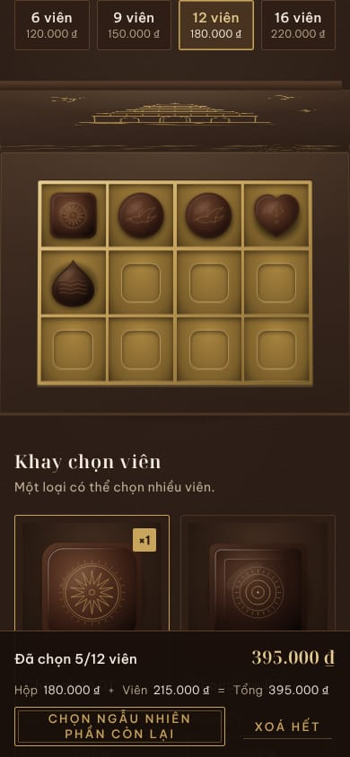
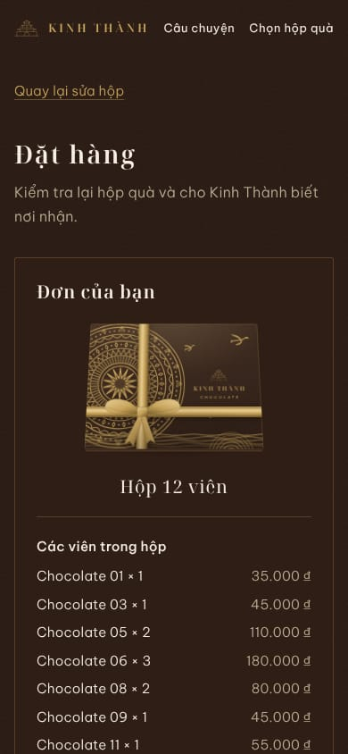

# Kinh Thành Chocolate – website

**English summary.** A Vietnamese-language storefront for a premium chocolate brand. Visitors pick a box size (6/9/12/16), place individual pieces into a 3D CSS gift box (drag and drop on desktop, tap-to-place on mobile), add a card message and submit an order. Frontend only: orders go to a mock service by default and can be pointed at a Google Apps Script endpoint. Built with Next.js 16 (App Router), React 19, TypeScript, Tailwind v4, Zustand, Zod, dnd-kit and Vitest. Quick start: `npm ci && npm run dev`, then open http://localhost:3000.

## Giới thiệu

Website chocolate cao cấp mang di sản Việt (trống đồng Đông Sơn, chim Lạc, cổng thành). Khách chọn cỡ hộp, xếp từng viên vào ô, thêm lời nhắn rồi đặt hàng. Giai đoạn hiện tại chỉ có frontend.

## Ảnh chụp

| Trang chủ (1440)                             | Mở nắp hộp (1440)                                 |
| -------------------------------------------- | ------------------------------------------------- |
|  |  |

| Xếp hộp (390)                                                | Đặt hàng (390)                                                 |
| ------------------------------------------------------------ | -------------------------------------------------------------- |
|  |  |

## Yêu cầu

- Node.js từ 20.9 trở lên, khuyến nghị 22 (xem `.nvmrc`)
- npm (đi kèm Node)

## Bắt đầu nhanh

```bash
npm ci
npm run dev
```

Mở http://localhost:3000. Biến môi trường là tuỳ chọn: sao chép `.env.example` thành `.env.local` nếu cần.

## Các lệnh

- `npm run dev` – chạy môi trường phát triển
- `npm run build` / `npm run start` – build và chạy bản production
- `npm run lint` – ESLint
- `npm run format` / `npm run format:check` – Prettier
- `npm run typecheck` – kiểm tra kiểu TypeScript
- `npm test` – Vitest (`npm run test:watch` để theo dõi)
- `npm run check` – chạy lần lượt typecheck, lint, format:check, test, build (giống CI)

## Cấu trúc thư mục

```
src/app                  Route, layout, metadata (icon, opengraph-image, robots, sitemap, 404)
src/features/            storytelling, box-builder, catalog, checkout
src/components/ui        Thành phần giao diện dùng chung
src/components/site      Thanh đầu trang, chân trang, skip-link
src/lib/                 services, schemas, utils
src/styles/tokens        Design tokens (màu, chữ, khoảng cách, chuyển động)
src/config               Cấu hình site (tên, tagline)
src/content              Nội dung chữ tiếng Việt
data/                    Dữ liệu JSON (chocolates, boxes)
public/chocolates        Ảnh chocolate (tạm)
public/media             Video + ảnh nền hero (tạm, xem public/media/README.md)
docs/                    Tài liệu dự án
```

## Thay dữ liệu và ảnh chocolate

Tên, giá, mô tả, ảnh của từng viên nằm trong `data/chocolates.json`, giá hộp theo cỡ trong `data/boxes.json`; ảnh đặt ở `public/chocolates/`. Không cần sửa code. Xem hướng dẫn ở [data/README.md](data/README.md).

## Thay video / ảnh nền hero

Video nền ở `public/media/hero.mp4`, ảnh hiện ngay và dùng khi giảm chuyển động ở `public/media/hero-poster.jpg`. Hai tệp hiện tại chỉ là bản tạm. Thay bằng tệp thật giữ NGUYÊN TÊN là xong, không cần sửa code. Khuyến nghị: 1920×1080, H.264 MP4 + AAC, ≤ 8–10 MB, lặp liền 10–20 giây, chủ thể nằm ở 55% bên phải khung hình (bên trái là chữ). Nếu video không có tiếng, đặt `heroVideoHasAudio: false` trong `src/config/media.ts`. Chi tiết (cả bản mobile tuỳ chọn): [public/media/README.md](public/media/README.md).

## Đặt hàng hoạt động thế nào

- Mặc định (`NEXT_PUBLIC_ORDER_ENDPOINT` để trống): chế độ mock, đơn chỉ được ghi ra console của trình duyệt sau khoảng 1 giây, không gửi đi đâu.
- Khi đặt `NEXT_PUBLIC_ORDER_ENDPOINT` là URL Google Apps Script, đơn được POST tới đó (`text/plain`, JSON).

Dạng dữ liệu đơn và mẫu `doPost` xem [docs/ORDER-PAYLOAD.md](docs/ORDER-PAYLOAD.md).

## Triển khai lên Vercel

1. Đẩy mã lên GitHub (xem bên dưới).
2. Trên Vercel chọn **Add New… → Project**, import repo `kinh-thanh-web`. Framework được nhận tự động là Next.js.
3. Ở **Environment Variables** đặt `NEXT_PUBLIC_SITE_URL` (địa chỉ công khai, ví dụ `https://ten-mien.vn`) và, khi đã có, `NEXT_PUBLIC_ORDER_ENDPOINT`.
4. Deploy.

## Tài liệu

- [docs/CONTEXT.md](docs/CONTEXT.md) – mục tiêu và luật nghiệp vụ
- [docs/DECISIONS.md](docs/DECISIONS.md) – các quyết định kỹ thuật và thiết kế
- [docs/BRAND.md](docs/BRAND.md) – nhận diện thương hiệu
- [docs/DESIGN-RULES.md](docs/DESIGN-RULES.md) – quy tắc thiết kế
- [docs/TASKS.md](docs/TASKS.md) – tiến độ
- [PRODUCT.md](PRODUCT.md) – sự thật về sản phẩm
- [DESIGN.md](DESIGN.md) – hệ thống thiết kế

## Đẩy lên GitHub

Tạo một repo trống `kinh-thanh-web` trên GitHub, rồi trong thư mục dự án:

```bash
git init
git add .
git commit -m "Kinh Thành Chocolate website – frontend MVP"
git branch -M main
git remote add origin https://github.com/<user>/kinh-thanh-web.git
git push -u origin main
```

CI (`.github/workflows/ci.yml`) sẽ chạy typecheck, lint, format, test và build trên mỗi lần push hoặc pull request vào `main`.
